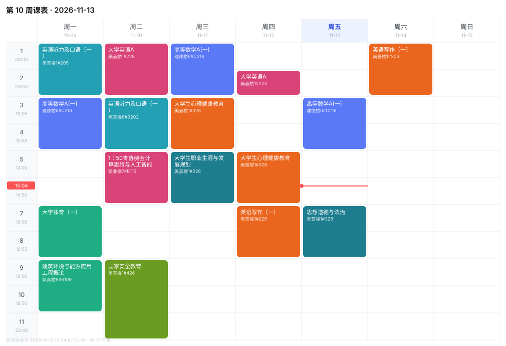

# 🎓 个人助手

> **本文件由 GitHub Actions 自动生成，请勿手工编辑**（改了也会被下次运行覆盖）。
> 最后更新：`2026-11-13 16:38:36 (UTC+8)` · 第 **10** 周 / 共 18 周
> 渲染每 20 分钟一次，学习通每小时一次，公告每天 3 次，日记每 20 分钟增量检查。

---

## 🧭 目录

README 只放每天要看的动态，**所有说明性文档都挂在下面**：

- 🏆 **[学科竞赛日历 2026–2027](docs/竞赛日历.md)** — 269 项校级竞赛目录 + 已核实的报名/比赛时间、大一资格门槛、建环专业长期目标。**手工维护，不会被 Actions 覆盖。**
- 🌐 [网页版看板](docs/index.html) · 📢 [值得关注的公告](docs/公告.md)（7 条） · 🎯 [潜在计划](docs/潜在计划.md)（15 项） · 📔 [名言全量](data/diary/quotes.json)
- 👤 **了解我**：[个人画像](docs/个人画像.md)（他是谁 / 关注什么 / 说话风格） · [开发习惯](docs/开发习惯.md)（15 条协作规则，接手 AI 必读）
- 🔧 **技术文档**：[技术路径](docs/技术路径.md) · [工作原理](docs/工作原理.md) · [数据结构](docs/数据结构.md) · [AI 提示词](docs/AI提示词.md) · [仓库结构](docs/仓库结构.md) · [常见问题](docs/常见问题.md)
- 🤝 **交接与运维**：[维护交接 AGENT.md](AGENT.md) · [开发文档 DEV_GUIDE.md](DEV_GUIDE.md) · [变更日志 CHANGELOG.md](CHANGELOG.md)
- 📎 **原始文件（已脱敏）**：[课表 ICS](assets/WakeUp导入课表.ics) · [竞赛目录 PDF](assets/河南城建学院2024年学科竞赛目录.pdf) · [学习通抓包 HAR](assets/抓包-学习通-脱敏.har) · [空间页抓包 HAR](assets/抓包-空间页-脱敏.har) — 脱敏口径与审计见 [原始文件说明](docs/原始文件.md)

---

## ⏰ 任务清单

**只列能做的任务**，共 4 项。全部课程按活跃度（作业发表数量）排序，组内按截止时间近 → 远；没任务的课写「无」。

| 课程 | 作业数 | 待完成 | 任务（截止近 → 远） |
| --- | --- | --- | --- |
| 高等数学A | 14 | 1 | [3-6函数图形的描绘3-7曲率](https://mooc1.huuc.edu.cn/mooc-ans/mooc2/work/task?courseId=219232606&classId=153566712&cpi=577967959&workId=58467962&answerId=0&enc=f4d70d033ef384444abee3d14c6b537e)（作业·11-15 23:57 ≈） |
| 建筑环境与能源应用工程概论 | 8 | 1 | [人造空间的热湿声光环境调控工程](https://mooc1.huuc.edu.cn/mooc-ans/mooc2/work/task?courseId=228141406&classId=157088208&cpi=577967959&workId=58204754&answerId=0&enc=b44f71b3bb99323ca0b941bba238632a)（作业·无截止） |
| 大学生心理健康教育（智慧课程） | 8 | **无** | — |
| 新世纪大学英语综合教程(一) | 3 | 2 | [Unit 1 words in action (第2-3大题)](https://mooc1.huuc.edu.cn/mooc-ans/mooc2/work/task?courseId=201780805&classId=156290484&cpi=577967959&workId=58170556&answerId=55245377&enc=a09ae9b3af415c3b6b1c6c0ff1635cd1)（作业·11-19 23:54 ≈） [unit 1 翻译](https://mooc1.huuc.edu.cn/mooc-ans/mooc2/work/task?courseId=201780805&classId=156290484&cpi=577967959&workId=58170689&answerId=55291283&enc=f4dedc558df97cac491d887b57101799)（作业·11-20 23:54 ≈） |
| 军事理论课教学 | 3 | **无** | — |
| 2026级-校规校纪 | 1 | **无** | — |
| 军事理论（同济大学版） | 1 | **无** | — |
| 2026-2027第一学期星期一下午七八体育课 | 0 | **无** | — |
| 国家安全教育 | 0 | **无** | — |
| 大学生职业生涯与发展规划 | 0 | **无** | — |
| 建筑环境与能源应用工程虚拟教研室 | 0 | **无** | — |
| 思想道德与法治（校级网络课程） | 0 | **无** | — |
| 新世纪大学英语综合教程(一) | 0 | **无** | — |
| 计算思维与人工智能 | 0 | **无** | — |

> 已剔除：逾期 1 项 · 开始超过 7 天 0 项 · 非待完成 33 项。课程按活跃度（作业发表数量）排序，共 14 门。

---

## 📅 本周课表

当前是 **第 **10** 周 / 共 18 周**，本周 17 节课。

| 星期 | 节次 | 时间 | 课程 | 教室 | 教师 |
| --- | --- | --- | --- | --- | --- |
| 周一 | 1-2 | 08:00–09:35 | 英语听力及口语（一） | 美荟楼1#205 | — |
| 周一 | 3-4 | 10:05–11:40 | 高等数学A(一) | 建德楼6#C216 | — |
| 周一 | 7-8 | 16:05–17:40 | 大学体育（一） | — | — |
| 周一 | 9-10 | 19:00–20:35 | 建筑环境与能源应用工程概论 | 筑真楼8#B109 | — |
| 周二 | 1-2 | 08:00–09:35 | 大学英语A | 美荟楼1#228 | — |
| 周二 | 3-4 | 10:05–11:40 | 英语听力及口语（一） | 筑真楼8#B202 | — |
| 周二 | 5-6 | 14:00–15:35 | 1：50青协例会计算思维与人工智能 | 建业楼7#B115 | — |
| 周二 | 9-11 | 19:00–21:25 | 国家安全教育 | 美荟楼1#426 | — |
| 周三 | 1-2 | 08:00–09:35 | 高等数学A(一) | 建德楼6#C216 | — |
| 周三 | 3-4 | 10:05–11:40 | 大学生心理健康教育 | 美荟楼1#328 | — |
| 周三 | 5-6 | 14:00–15:35 | 大学生职业生涯与发展规划 | 美荟楼1#226 | — |
| 周四 | 2 | 08:50–09:35 | 大学英语A | 美荟楼1#224 | — |
| 周四 | 5-6 | 14:00–15:35 | 大学生心理健康教育 | 美荟楼1#328 | — |
| 周四 | 7-8 | 16:05–17:40 | 英语写作（一） | 美荟楼1#228 | — |
| 周五 | 3-4 | 10:05–11:40 | 高等数学A(一) | 建德楼6#C216 | — |
| 周五 | 7-8 | 16:05–17:40 | 思想道德与法治 | 美荟楼1#328 | — |
| 周六 | 1-2 | 08:00–09:35 | 英语写作（一） | 美荟楼1#203 | — |

---

## 📔 我的名言

从自己写的日记里摘录的原话，一字未改。

>
> 英国签证面签态度

> 我不想被信息牵着走了
>
> 写日记目录用途时

> 我要找回自己的注意力
>
> 写日记目录用途时

>
> 开篇自我提醒
>
> 💬 哼，光喊口号谁不会？别误会我才没催你——把「想要什么」拆成三个小目标写下来。

> 今天就开始，不要往宿舍里待了，保持自己的个人卫生，锻炼，记录，学习
>
> 今日记录开篇自勉 — 2026-11-12

> 现在只是需要寻找到自己真正想要什么就可以了，寻找一个自己真正想做的事情，只需要一个就好
>
> 今日记录中的自我反思 — 2026-11-06

> 今天戒烟3天没毛病
>
> 记录戒烟进展 — 2026-10-15

> 最近的任务完成的很好，事情都完成了接下来的时间就学习数学吧
>
> 任务完成后的自我安排 — 2026-10-15

---

## 📊 数据源状态

| 数据源 | 状态 | 最近成功 | 规模 |
| --- | --- | --- | --- |
| 学习通作业 | ✅ 正常 | 2 分钟前 | 14/14 门课，38 条任务 |
| 校园公告 | ✅ 有数据 | 刚刚 | 78 条入库 |
| Gitee 日记 | ✅ 有数据 | 2 分钟前 | 23 个 md 文件 |
| WakeUp 课表 | ✅ 已解析 | 刚刚 | 186 条上课记录 |

---

技术路径见 [docs/技术路径.md](docs/技术路径.md) · 维护交接见 [AGENT.md](AGENT.md) · 开发文档见 [DEV_GUIDE.md](DEV_GUIDE.md) 
结构参考 <a href="https://github.com/jiuyuan233/wool-gathering">wool-gathering</a> · 推送方案参考 <a href="https://github.com/jiuyuan233/Lottery-BiliBiliToolB-Web233">Lottery-BiliBiliToolB-Web233</a>
